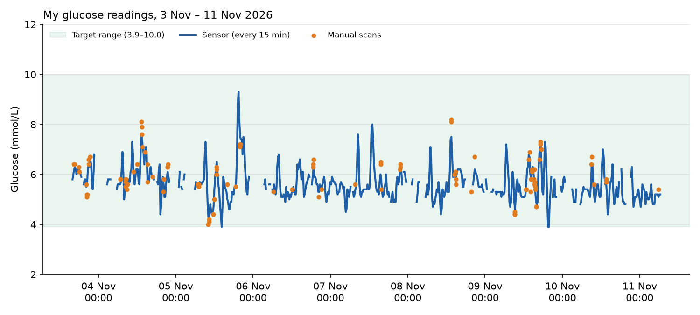

# My Glucose Readings
{: .no_toc }

  

    Table of contents
  

  {: .text-delta }
- TOC
{:toc}

I'm wearing a FreeStyle Libre sensor, which reads my blood glucose every 15 minutes. This page shows my latest readings, and I refresh it whenever I pull new data from LibreView.

## Latest readings

<!-- glucose-summary:start -->
_Last updated 5 Nov 2026, 06:29 (Singapore time). Covers 39 hours of sensor data._

  <canvas role="img" aria-label="Interactive line chart of my glucose readings from 3 Nov 2026, 15:57 to 5 Nov 2026, 06:29, average 6.0 mmol/L, with my 7.8 mmol/L ceiling marked. Hover or tap a point for details."></canvas>

<noscript></noscript>

- **Average glucose:** 6.0 mmol/L
- **Lowest / highest:** 4.4 / 7.6 mmol/L
- **Time in range (3.9–10.0 mmol/L):** 100%
- **Above 7.8 mmol/L (my ceiling):** 0% of sensor readings, 2 of 38 scans; peak 8.1 at 4 Nov 2026, 13:17
- **Readings:** 109 sensor readings, 38 manual scans
<!-- glucose-summary:end -->

## How to read the chart

- **Blue line:** the sensor's automatic reading, every 15 minutes.
- **Orange dots:** the times I scanned the sensor with my phone.
- **Green band:** 3.9–10.0 mmol/L, the target range most CGM reports use.
- **Gaps in the line:** times the sensor didn't record a reading.
- **Red dashed line:** 7.8 mmol/L, the ceiling I'm aiming to stay under. Scans above it show as red dots.
- **Purple triangles:** notes I logged in the LibreLink app, like what I ate.
- **Hover or tap any point** to see its exact value and time, how far it is from my ceiling, how much it changed since the previous reading, and that day's average, low and high.

{: .warning }
This is my own personal data, shared for interest only. It's not medical advice.

Until next time, peace and love!
