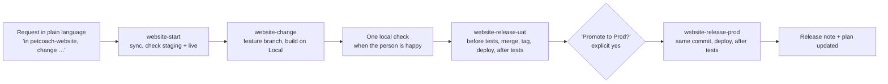

# Running a Small Business Website Like a Software Team, With Claude Code
{: .no_toc }

  

    Table of contents
  

  {: .text-delta }
- TOC
{:toc}

Pet Coach SG (petcoach.sg) is a small dog training business that Qiai and I run together. The website is WordPress, and for years it was managed the way most small business sites are: someone logs into wp-admin, changes something, and hopes nothing else broke. Over two weeks in November 2026 I rebuilt how the site gets changed, so that it now works like a proper software release process: one repository, a local copy of the site on each Mac, a staging site, tagged releases, and automated tests before and after every deploy.

The interesting part isn't the pipeline itself. Software teams have had pipelines forever. The interesting part is **who runs it**: every step is driven by Claude Code skills, so a business owner who has never typed a git command can say "change the footer" or "put it on staging" and get the same discipline a dev team would. This post is the overview of the whole initiative, and the six posts after it go deep on each piece.

{: .highlight }
This is live. Every change to petcoach.sg now goes through this flow, including a three-part release on 25 November 2026 that removed Elementor from the whole blog. It's built for two people (one technical, one not), each on their own Mac: mine runs it today, and Qiai's Mac is being set up from the same repo.

## The problem: a live site that nobody could vouch for

On 23 November I compared the site's page designs, which I kept in a git repo, against what was actually live. Two pages didn't match:

- The **Separation Anxiety Checker** page had GA4 tracking code that had been pushed straight into WordPress from a different project (my SEO pipeline) a month earlier, and never committed anywhere. The "source" in the repo was already out of date.
- Another page had been **edited directly in wp-admin** by Qiai a couple of weeks before. Perfectly reasonable edit, but the repo didn't know about it, so the next time I published from the repo I would have silently wiped it out.

Neither was a disaster on its own. Together they showed the real problem: **there was no single place that described what the live site should be**, and no safe place to try changes before visitors saw them. On top of that:

- **Elementor everywhere.** The header, footer, blog listing and every blog post template were Elementor Theme Builder templates. Changing them meant clicking around a page builder on the live site, with no history and no undo beyond a full hosting backup.
- **No staging.** Every change was tested in production, on real customers.
- **Two people, two Macs, two Claude setups.** Qiai updates pages too, from her own Mac and her own Claude Code. Without a shared process, "who changed what, when" lived in WhatsApp messages.
- **Testing was manual.** I had a Playwright script for plugin updates (see [Automated testing -- plugin updates!](/tech-adventures/wordpress/automated-testing-plugin-updates)), but nothing that told me "this release changed exactly these things and nothing else."

## What a business owner actually needs

Before designing anything, I wrote down what "good" had to mean for us, because it's different from what a dev team needs:

1. **Live is protected.** Nothing reaches petcoach.sg without being tested on a copy first, and without one of us saying "yes" in plain words.
2. **Every change is traceable.** What changed, who asked for it, when it went live, how to undo it.
3. **Nothing technical is required of the person asking.** Qiai should be able to say "update the pricing on the separation anxiety page" and never see the words "rebase" or "FTP".
4. **It survives two people.** Both of us can work at the same time without overwriting each other.
5. **It stays cheap and simple.** Shared hosting, a free GitHub account, no CI servers to babysit.

## The solution in one picture

The building blocks, each with its own deep-dive post:

| Piece | What it does | Deep dive |
|---|---|---|
| One repo, three sites | `petcoach-website` holds the theme, mu-plugins, page builds, header/footer, redirects and migrations. Local (on each Mac), Staging, Live. Code flows up, data flows down. | [One Repo, Three Sites](/tech-adventures/wordpress/claude-website-local-staging-live) |
| Release tests | Playwright snapshots of ~126 URLs at desktop and mobile, before and after every deploy, compared against a written list of what the release is *supposed* to change. | [Before and After](/tech-adventures/wordpress/claude-website-release-tests) |
| Claude skills | A router skill on each Mac plus six `website-*` skills in the repo, shaped around how each of us actually talks to Claude. | [Skills for Business Users](/tech-adventures/wordpress/claude-website-skills-for-business-users) |
| Two-person rules | Staging holds one batch that ships whole, branches belong to whoever started them, hotfixes only for emergencies. | [Two People, One Website](/tech-adventures/wordpress/claude-website-two-people-one-site) |
| A real release | Removing Elementor from the blog: three changes batched, tested and shipped together. | [Case Study: Removing Elementor](/tech-adventures/wordpress/claude-website-elementor-removal-case-study) |
| Standalone repo | Everything needed to build Local and deploy lives in the repo plus the Mac's Keychain, so a second Mac is a clone away. | [Making the Repo Standalone](/tech-adventures/wordpress/claude-website-standalone-repo) |

## What it looks like from the business side

Here's the part I'm proudest of. For a non-technical user, a full release is just a conversation. This is how the intro-typo fix from the blog release played out, written the way the skills talk to Qiai:

> **Qiai:** in petcoach-website, the blog intro says "liked-minded", fix it
> **Claude:** *Website change: checking the latest from the repo and what's on staging and live…* The test site is free. I've fixed it on your own copy of the site at local.petcoach.sg, have a look.
> **Qiai:** looks good, put it on staging
> **Claude:** *(runs the before tests, merges, tags, deploys, runs the after tests)* It's on staging.petcoach.sg. Tests: 0 failures, the only differences are the ones we expected. Promote to the live site?
> **Qiai:** yes
> **Claude:** *(deploys, tests the live site again)* Live. Release note written.

She never sees a branch name unless she asks. The skills are written to speak in "your own copy of the site", "the test site" and "the live site", and every one of those steps still produces a git tag, a release note and a test report that I can audit afterwards.

{: .important }
The discipline lives in the skills and the repo's rules, not in the person's head. That's what makes it work for a non-technical business user: they can't forget a step they never had to know about.

## The rules that hold it together

The repo's `CLAUDE.md` has fifteen numbered rules, each added the day a real situation needed it. A few carry most of the weight:

- **Code flows up, data flows down.** Code goes Local → Staging → Live. Databases only ever get copied *from* live *to* staging and Local, never the other way.
- **Only promote a tested commit.** A `prod-*` tag can only go on a commit that already has a `uat-*` tag and a passing staging test.
- **Release tests before and after every promotion, all of them, every time.**
- **Nothing goes live without an explicit yes in chat** for that specific release.
- **A branch belongs to whoever started it.**
- **Never edit the live site directly**, not even for a "quick fix". If someone does, a dedicated skill copies the live version back into the repo before anyone builds on top of it.

## Where it is today

- **In use since 23 November 2026**: five staging releases and two production releases in the first three days (`prod-2026-11-24-1`, the staging safety guard and relative header/footer links; `prod-2026-11-25-1`, the whole blog off Elementor as one batch of three). The header and footer had moved off Elementor the day before, as the first piece of code the new repo owned.
- **Both Macs:** mine is fully set up with a local copy of the site; Qiai has accepted the GitHub invite and her setup is next, with Claude installing anything her Mac is missing.
- **Still open, honestly:** a migration runner with a per-site ledger is still a simple per-migration script, the drift check covers code files but not yet plugin versions, menus or page content, and two small gaps in the release skills (a fresh fetch right before merging, and comparing tests across two Macs) are noted and not yet built.

## Conclusion

The short version: a small business site doesn't need a dev team to get dev-team safety. It needs one place that describes the site, a copy to test on, tests that know what a release is *meant* to change, and a way to run all of that without the person asking having to know any of it. Claude Code skills turned out to be a very natural fit for that last part. The next post starts at the foundation: one repo, three sites.

Until next time, peace and love!
