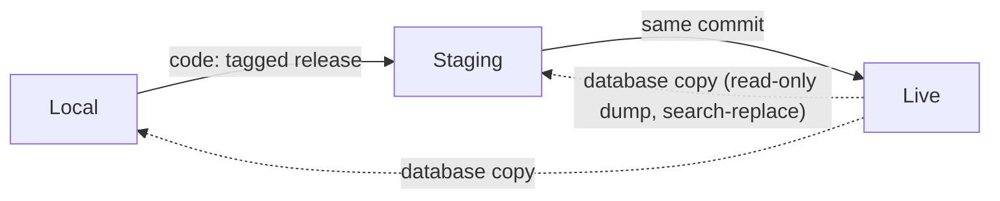

# One Repo, Three Sites -- Local, Staging and Live for a Small WordPress Business
{: .no_toc }

<details closed markdown="block">
  <summary>
    Table of contents
  </summary>
  {: .text-delta }
- TOC
{:toc}
</details>

This is part 2 of the series that starts with [Running a Small Business Website Like a Software Team](/tech-adventures/wordpress/claude-website-initiative-overview). That post covered *why*. This one covers the foundation everything else stands on: one repository that describes the site, and three copies of the site to move changes through.

## One repo: `petcoach-website`

The first decision was the least glamorous and the most important: **one new repository, not a rename of the old one.** I already had a repo for page designs (`petcoach-web-design-pages`), and an SEO repo that had quietly accumulated site code over the months: the child theme, two mu-plugins, the `.htaccess` redirects. Renaming would have dragged all that ambiguity along, so I started clean and *imported* what belonged, with history.

Today the repo holds everything that makes the site behave the way it does:

```
petcoach-website/
  wp-content/themes/astra-child/   the child theme
  wp-content/mu-plugins/           every mu-plugin (blog templates, fonts, tracking, environment guard)
  site-chrome/                     header + footer, built to static HTML
  pages/<page>/                    pages built here (design source → built HTML)
  redirects/                       the .htaccess custom-redirects block, with its history
  migrations/                      database/content changes as guarded scripts
  releases/                        expectations, deploy steps and a note for every release
  tests/                           release-test cases and environment rules
  .claude/skills/                  the website-* skills
  claude/router/                   the router skill each Mac links to
  plan/                            the plan, versioned (v1 → v6 so far)
```

{: .important }
The rule that decides what goes in: **the repo is chosen by what is edited, not why.** An SEO task that edits a page is a website change. Blog post *wording* stays in the SEO repo; how posts *look or work* lives here. More on that split in [Two People, One Website](/tech-adventures/wordpress/claude-website-two-people-one-site).

## Three sites

| Name | Address | Role |
|---|---|---|
| **Local** | `http://local.petcoach.sg`, on each Mac | Build and look. Iterate freely. |
| **UAT / Staging** | `https://staging.petcoach.sg` | Test the release, with the full automated tests. noindex. |
| **Prod / Live** | `https://petcoach.sg` | Customers. |

### Local: a real copy of the site on the Mac

Previously I ran WordPress locally on Windows under WSL ([My Local Wordpress Setup](/tech-adventures/wordpress/my-local-wordpress-setup)). This time the goal was stricter: Local must behave like the live server, closely enough that a change which looks right on Local looks right on Live.

- **Apache, not Caddy or `php -S`.** The live host runs LiteSpeed, which reads `.htaccess`. Apache reads the same file, so redirects and rewrite rules behave the same. I picked Apache over Caddy for exactly that reason.
- **PHP 8.2 FPM, the same version as live**, WordPress pinned to live's version, the same plugins copied down from staging.
- **The live database**, copied down read-only and search-replaced to the local address.
- **A hosts-file line** (`127.0.0.1 local.petcoach.sg`), so the address is real and nothing about the site has to know it's local.

The whole thing is one script with a handful of commands:

```bash
npm run local -- install   # one-time: Homebrew packages, hosts line, Apache + PHP config
npm run local -- setup     # WordPress, plugins, live data, our code   (~40 min first time)
npm run local -- uploads   # all media (~1.3 GB) so image sizes match live
npm run local -- verify    # same 7 pages on Local and Live, compared → expect 0 FAIL
npm run local -- sync      # copy the repo's code in (what you run while iterating)
npm run local -- refresh   # fresh copy of the live database
```

{: .warning }
macOS gotcha: background services (like the Apache started by `brew services`) are not allowed to read anything under `~/Documents`, which is where my repos live, so a site pointed straight at the repo can't be served. The fix is to keep the Local site in `~/Sites/local.petcoach.sg` and have `sync` **copy** the repo's code in, rather than pointing Apache at the repo.

### Staging: a copy that can't hurt anyone

Staging is a clone of live, with one extra mu-plugin that is the whole reason it's safe to use: **the environment guard**. It does nothing on petcoach.sg and switches off every real-world side effect everywhere else. Straight from its header:

```php
/**
 * Plugin Name: Pet Coach environment guard
 * Description: Does nothing on petcoach.sg. On every other copy of the site (UAT https://staging.petcoach.sg, Local)
 *              it stops real-world side effects, so a database refresh from Prod is safe to use straight away:
 *              - GA4: the MonsterInsights plugin is not loaded, so no gtag and no events (pc-lead-tracking and the
 *                page tools all check for gtag before sending).
 *              - Acuity: the booking iframe/embed script is replaced with a notice, so no real appointments.
 *              - Email: wp_mail() sends nothing (form notifications, password resets, plugin mail).
 */
function pc_env_is_prod() {
	$host = parse_url( get_option( 'home' ), PHP_URL_HOST );
	return 'petcoach.sg' === $host || 'www.petcoach.sg' === $host;
}
if ( pc_env_is_prod() ) {
	return;
}
```

It also puts a red **TEST SITE** badge in the corner, so nobody ever mistakes staging for live in a screenshot. The same file is deployed to every site, so there's no "staging version" of the code to drift.

Staging stays **noindex only, no password**, a deliberate choice: noindex keeps it out of Google, and with no password the automated tests (including the WhatsApp/Facebook link-preview checks) and a quick "have a look at this" link to Qiai just work.

{: .warning }
Staging and live share one Cloudflare zone. Cloudflare's "Purge Everything" button on staging would also purge live. Staging caches are purged **by URL prefix only**, never "everything".

## Releases: tags, markers and a switch

### Tags tell you what was tested

```
feature/<task>        → built and checked on Local
main + uat-2026-11-25-2 → deployed to staging, tested
prod-2026-11-25-1     → the SAME commit, deployed to live, tested again
```

A `prod-*` tag can only go on a commit that already has a `uat-*` tag and a passing staging test. That one rule means "what's live" is always "something that was tested, byte for byte".

### Each site says what it's running

Every deploy writes a tiny file to the site, `/wp-content/pc-release.json`. This is the real one on live right now:

```json
{"release":"prod-2026-11-25-1","from":"uat-2026-11-25-2",
 "batch":["uat-2026-11-24-1","uat-2026-11-25-1","uat-2026-11-25-2"],
 "commit":"21b9245","deployedAt":"2026-11-25T06:42:19Z","by":"Claude (Shafik approved)"}
```

Anyone (or any Claude session) can `curl` it and know exactly which commit a site runs, which releases it contains and who approved it. The start skill reads it on every request to tell whether staging is "free" or holding a batch.

### Rollback is deleting one file

New features ship as mu-plugins that only switch on when a file called `ENABLED` sits next to them:

```php
function pc_blog_active() {
	return file_exists( PC_BLOG_DIR . 'ENABLED' ) && is_readable( PC_BLOG_DIR . 'archive.php' );
}
```

Deploys upload the code first (it's inert), check nothing changed, then upload the switch. If something looks wrong on live, deleting `ENABLED` puts the old behaviour back instantly, no redeploy, no database restore.

{: .note }
This is also how the header and footer moved off Elementor: the new header/footer shipped behind a switch, got tested on a noindex test page first, and only then rolled out site-wide.

## Code flows up, data flows down



Databases never travel up. If a change needs data to change (a page's content, a menu item, a post's HTML), it's written as a **migration**: a script in the repo with the exact before and after, which refuses to write if the site doesn't match the "before" it expects. The daycare blog post in the [Elementor case study](/tech-adventures/wordpress/claude-website-elementor-removal-case-study) was the first one.

## Conclusion

One repo that describes the site, three copies to move changes through, tags that prove what was tested, a marker on each site that says what it runs, and a one-file switch for rollback. None of it is exotic, and that's the point: it's small enough for a two-person business to own. What makes it trustworthy is the next piece, the tests that run before and after every deploy: [Before and After: the Release Tests](/tech-adventures/wordpress/claude-website-release-tests).

Until next time, peace and love!
