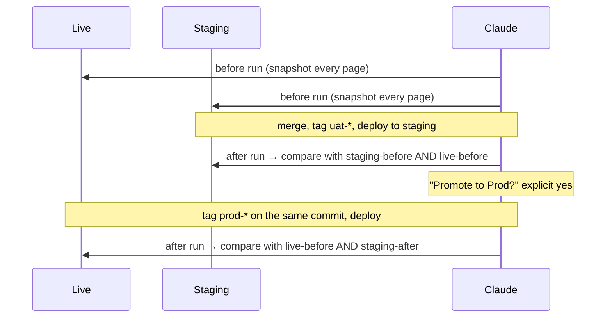

# Before and After -- The Release Tests That Guard Every Deploy
{: .no_toc }

<details closed markdown="block">
  <summary>
    Table of contents
  </summary>
  {: .text-delta }
- TOC
{:toc}
</details>

Part 3 of the series (start at the [overview](/tech-adventures/wordpress/claude-website-initiative-overview)). The [previous post](/tech-adventures/wordpress/claude-website-local-staging-live) set up one repo and three sites. This one is about the thing that makes promoting a release a calm decision instead of a nervous one: the tests.

Some background: I've used Playwright on this site before, to take screenshots around plugin updates ([Automated testing -- plugin updates!](/tech-adventures/wordpress/automated-testing-plugin-updates)). That told me "these pages look roughly the same." What a release needs is sharper: **"this release changed exactly what it was supposed to, and nothing else."**

## The shape: four runs per release



Each run is one command:

```bash
npm run release-test -- --env uat  --phase before --tag uat-2026-11-25-2
npm run release-test -- --env prod --phase after  --tag uat-2026-11-25-2
```

A run visits every page and post (126 URLs today, plus the blog's page 2 and each category archive) at **desktop and mobile**, so 252 snapshots, in about 9 to 11 minutes. Claude runs both "before" runs in parallel in the background and reports progress every two minutes.

## What a snapshot captures

For every page, every viewport, the snapshot records far more than a screenshot. These are the regression checks it runs, from the repo's `tests/TEST-CASES.md`:

| Test | What it checks | Severity |
|---|---|---|
| REG-02 | `<title>`, meta description, canonical, robots unchanged | FAIL |
| REG-04 | Link-preview tags (og:*, twitter:*) unchanged | FAIL |
| REG-05 | H1 count unchanged; no new sideways scroll | FAIL |
| REG-06 | No new JS errors, no new failed requests to our domain | FAIL |
| REG-07 | No font that now fails to load | FAIL |
| REG-08 | Text: nothing missing (FAIL), anything added (WARN) | FAIL / WARN |
| REG-09 | **Text styling: font family, size, weight, colour, alignment** | FAIL |
| REG-11 | **Image size and horizontal position** (2px / 2% tolerance) | FAIL |
| REG-12 | Icons present, same size, position, colour | FAIL |
| REG-13 | Elementor widgets present, not collapsed | FAIL |
| REG-18 | Screenshot pixel difference, body and header/footer separately | WARN |
| REG-19 | LiteSpeed still serving the page from cache | FAIL |

Plus site-wide checks: robots.txt, every sitemap URL indexable on live (and *every* page noindex on staging), canonicals on the right domain, GA4 present on live and absent on staging, the booking embed present on live and replaced on staging, and a WhatsApp/Facebook preview check on every page (image loads, right format, at least 200×200, under 300 KB).

{: .note }
Body and header/footer are compared separately on purpose. A footer change shouldn't drown in "every page changed by 3%", and a body change shouldn't hide behind a footer that legitimately moved.

## The key idea: write down what should change, before deploying

A diff of "before vs after" on its own is useless: every intended change shows up as a failure. So every release carries an **expectations file**, written *before* deploying, from what the change is supposed to do. This is a real one, from the blog release:

```json
{
  "release": "uat-2026-11-24-1",
  "description": "Elementor removal step 1: /blog/ and post archives rendered by pc-blog (mu-plugin) instead of Elementor's archive template 2264. ... Copy fix asked by Shafik: 'liked-minded' → 'like-minded' in the blog intro.",
  "rules": [
    {
      "id": "blog-archive-no-elementor",
      "why": "the archive is no longer an Elementor template",
      "pages": "*",
      "match": "^Elementor widget\\(s\\) missing: heading\\.default, text-editor\\.default, wp-widget-categories\\.default, archive-posts\\.archive_cards$",
      "mustAppear": true
    },
    {
      "id": "blog-intro-typo-new",
      "why": "the corrected intro sentence",
      "pages": "*",
      "match": "^Text added \\(1\\): p: Welcome to the Pet Coach Blog\\. Here, we aim to share information that would help like-minded ",
      "mustAppear": true
    }
  ],
  "previews": []
}
```

Two things make this work:

- **Every rule has a `why`.** If a rule ever matches something odd, the reason it exists is right there.
- **`mustAppear: true` proves the change actually landed.** If the Elementor widgets *didn't* disappear, the run fails, even though "nothing changed" would otherwise look like a pass.

{: .warning }
The one rule about rules: **never widen an expectation just to make a run pass.** A rule describes what the change should do. If a run fails, the question is "is the site wrong, or did I describe the change wrongly?", and only the second answer allows editing the rule.

## Known issues don't block, new ones do

The "before" run is the baseline. Anything already failing before the release (for example, the blog listing has no `og:image`, so WhatsApp previews of `/blog/` show no picture) is reported as **KNOWN** and doesn't block. Only *new* failures block. That keeps old problems visible without holding every release hostage to them. They get their own release.

## Each comparison answers one question

After a staging deploy, the after-run makes two comparisons:

1. **Staging before vs after:** did this release change only what it said it would?
2. **Staging after vs live before:** is staging exactly *live plus this release*? (with a small, permanent list of allowed environment differences: noindex, the booking notice, the badge)

After a live deploy:

1. **Live before vs after:** only the expected changes.
2. **Live after vs staging after:** is live now identical to what was tested?

This is the real summary from the last staging run before the blog went live, a batch of three releases:

```
## UAT after vs Prod (UAT must equal Prod + this release)
Before: 20261125_0600-prod-before-uat-2026-11-25-2 · expectations: env-uat-vs-prod.json, expect-batch.json
0 FAIL, 18 WARN, 234 OK, 1409 finding(s) matched expected changes.
```

1,409 individual differences, every one of them accounted for by a written rule, and zero unexplained.

## Finding #1: my own rule was wrong, and the test said so

The first staging run of the blog release came back with **6 FAILs**, all on three category pages: Canine Fitness & Hydrotherapy, Canine Scent Work, Dog Boarding & Daycare. Each one said:

```
Text missing (1): p: Welcome to the Pet Coach Blog. Here, we aim to share information that would help liked-minded dog lovers …
```

That's the typo fix, which is exactly what we wanted. So why a FAIL? My rule expected the old sentence to disappear *together with* the Load More button text (reported as "Text missing (2)"), because that's what happened on the big listing pages. Those three small categories have too few posts for a Load More button, so the old sentence disappeared on its own: "Text missing (1)".

The site was right; my description of the change was incomplete. I fixed the rule to cover both shapes, while still only accepting *that one sentence* going away, re-ran, and got 0 FAIL. Both runs are in the release note.

{: .important }
A test that fails because the expectation was wrong is still doing its job: it forced me to check that the change behaves the same on small pages as on big ones. It took one rule edit, with a reason written down.

## Finding #2: the tests don't check the deploy itself

During the live deploy of the blog batch, the old upload tool printed a blank line for one file (`single.js`, which drives the table of contents and the reading progress bar) instead of "Upload complete". No error. I only caught it because I re-checked every file on the server before uploading the switch files.

The release tests would have caught the *symptom* afterwards (no table of contents → missing text and widgets), but that's after customers see it. So the deploy now checks itself: the new deploy script **re-downloads every file it uploads and compares checksums**, and stops before flipping any switch if one doesn't match. Details in [Making the Repo Standalone](/tech-adventures/wordpress/claude-website-standalone-repo).

## Local: iterate freely, check once

At first Claude ran a check on Local after every tweak, and on a template change that also meant sweeping dozens of posts. After a couple of days of that, my verdict was simple: development on Local was taking too long. So the rule for Local became:

- **While iterating:** copy the code in and look at the page. No tests.
- **Once, when the person is happy:** `npm run local-check`, which compares just the pages the change touches (desktop, mobile and 320px) against a baseline taken when the branch started, using the same comparison engine and the same expectations file the release will use.
- **The full regression** runs only on staging and live.

That one change made building feel fast again without giving up anything: the local check is the same logic, just scoped.

## Batches: expectations that add up

When several releases sit on staging together (they ship as one batch, see [Two People, One Website](/tech-adventures/wordpress/claude-website-two-people-one-site)), each release's expectations file lists the earlier ones in `"includes"`. Staging-before-vs-after uses only the newest release's rules (what it adds), while comparisons against live use **all** of them merged, because live is missing the whole batch.

## Conclusion

The tests turned "I think it's fine" into "here's the list of every difference and the reason for each one". The two most valuable habits weren't technical: write down what should change *before* deploying, and never edit a rule just to get a green run. And honestly, the most important lesson came from a gap, not a test: verify the deploy itself, not just the site afterwards. Next: how all of this is driven by Claude skills that a non-technical business owner can use, in [Skills for Business Users](/tech-adventures/wordpress/claude-website-skills-for-business-users).

That's a wrap! Peace and love, Shafik.
