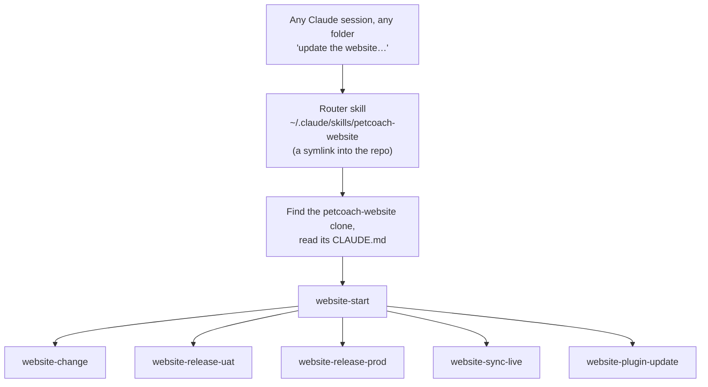

# Claude Skills Shaped Around How Business Users Actually Ask
{: .no_toc }

<details closed markdown="block">
  <summary>
    Table of contents
  </summary>
  {: .text-delta }
- TOC
{:toc}
</details>

Part 4 of the series (overview [here](/tech-adventures/wordpress/claude-website-initiative-overview)). The [repo and three sites](/tech-adventures/wordpress/claude-website-local-staging-live) and the [release tests](/tech-adventures/wordpress/claude-website-release-tests) are the machinery. This post is about the part that lets a business owner drive that machinery without learning it: the Claude Code skills.

## Design principle: start from how people talk

I didn't design the skills around the pipeline's steps. I designed them around the sentences Qiai and I actually say to Claude:

| What someone says | What it really means | Skill |
|---|---|---|
| "change the pricing on the SA page", "fix the footer", "new page for…" | build something on a branch, check it on Local | `website-change` |
| "put it on staging", "let me test it", "release this" | tested release to the staging site | `website-release-uat` |
| "ship it", "put it live", "publish" | promote what passed on staging | `website-release-prod` |
| "I changed the About page in wp-admin" | live has an edit the repo doesn't know about | `website-sync-live` |
| "update the plugins", "run the site check" | plugin/core updates through the same flow | `website-plugin-update` |
| *anything at all about the site* | sync first, see what's on staging and live | `website-start` (always first) |

Each skill's `description` (the only part Claude sees until it decides to use a skill) is written as a list of those phrases. The `website-start` one, for instance, begins: *"The mandatory first step for ANY petcoach.sg website request in this repo — page edits, new pages, design, header/footer, menus, styles, plugins, redirects, releases, 'run the site check'…"*

## The two layers: a router on each Mac, skills in the repo



- **The router** lives in the repo (`claude/router/`) and is **symlinked** once per Mac into `~/.claude/skills/`. User-level skills load in every session on that Mac, from any folder, so "update the website" works even if Claude was opened for something completely different. Because it's a symlink, every `git pull` updates it.
- **The `website-*` skills** live in the repo's `.claude/skills/`, so they are versioned with the code they operate on and identical on both Macs. Change a skill → branch → merge → both people get it on their next pull.

The router's whole job fits in three steps. From its file:

```markdown
1. **Find the repo.** Shafik and Qiai both update the site, each from their own Mac with their own clone. …
2. **Read `petcoach-website/CLAUDE.md` in full** (reading a file there is what makes the repo's skills load
   when the repo is a subfolder of the session folder).
3. **Run the `website-start` skill** for the request, and follow it from its first line
   ("Website change: checking the latest from the repo and what's on staging and live…").
```

It also says what *isn't* this repo (blog post wording lives in the SEO repo, the shop and the group-class site are different projects), and ends with the rule that matters most: *never edit petcoach.sg directly, not even for a "quick fix".*

## `website-start`: the preflight that runs every time

Every request starts with the same line, word for word:

> Website change: checking the latest from the repo and what's on staging and live…

That line is a **tripwire for humans**. If Claude ever starts changing the site without it, the person knows the flow was skipped and says "use petcoach-website". Behind the line, the skill:

1. **Syncs with GitHub** (fetch, fast-forward `main`; stops if `main` moved outside the flow).
2. **Lists open work**: every unmerged branch, whose it is, and which files it touches, flagging overlap with this request.
3. **Reads each site's `pc-release.json`** to see whether staging is free or holding a batch, and whether that batch is due on live (3 days max).
4. **Checks the local copy of the site** (running? data older than two weeks? plugin versions match live?).
5. **Checks live vs repo** for the pages being touched. If someone edited live in wp-admin, `website-sync-live` copies that edit back first, so nothing gets overwritten.
6. **Checks this Mac's setup** (Keychain entries by name only, the WordPress connection).

Then it hands over to the right skill.

## Speaking business, not git

The skills have an explicit language rule: *"Qiai doesn't use git: never show branch names, merges or git commands to her unless she asks. Shafik is fine with them."* And the three sites always get the same names:

- "your own copy of the site at local.petcoach.sg"
- "the test site, staging.petcoach.sg"
- "the live site, petcoach.sg"

Same flow underneath, same tags and release notes, very different conversation on top. I get `uat-2026-11-25-2` and `git merge --no-ff`; Qiai gets "it's on the test site, have a look".

## Approvals are part of the skills, not a habit

The places where a human must decide are written into the skills as hard gates:

- **Promoting to live** needs an explicit "yes" in chat *for that release*. An earlier yes doesn't carry over.
- **Merging skills/docs changes** to `main` needs approval too (they change how every future session behaves).
- **Copy changes**: only the wording that was asked for. Anything else ("this compliance line could be clearer") is raised in chat, not quietly added.
- **Messages to people** (the WhatsApp note after a release) are drafted, shown, and sent only after the exact text is approved.

## Two Macs, two loading behaviours

This took real reading of the Claude Code docs to get right:

- **On my Mac**, Claude runs in a VS Code workspace with many folders, the repo being one of them. Its skills load at startup.
- **On Qiai's Mac**, Claude starts in her root folder and the repo is a subfolder. Subfolder skills are **deferred**: they load the first time Claude reads a file inside that folder. That's why the router's step 2 is "read `CLAUDE.md`": reading it is what pulls the skills in. The fallback, typed once at the start of a session, is `/add-dir petcoach-website`.
- **A line in her root `CLAUDE.md`** ("any change to petcoach.sg goes through petcoach-website") is the third trigger, because a `CLAUDE.md` in the start folder always loads.

Three triggers (router, root `CLAUDE.md` line, naming the project in the request), so no single one has to be perfect.

## Finding: the day the skills silently didn't load

On 24 November I did the first Elementor-removal change (the blog listing) and it went well, until I asked Claude why it hadn't printed the start line. It turned out **the session had started before the new repo existed in my workspace**. Only the router and the *old* repo's skills were loaded, so Claude had followed the website skills "from memory" by reading their files, and in doing so skipped a step: the 320px phone-width screenshot review.

Nothing broke, but it was exactly the kind of silent drift this whole design exists to prevent. Three fixes came out of it:

1. A saved instruction for Claude: if the `website-*` skills aren't in the session's skill list, **say so immediately** and recommend a new session; never quietly follow the files instead.
2. The start line as a human-visible tripwire (above).
3. A habit: after setting up or restructuring skills, open a fresh session and ask Claude to confirm they're loaded. I did exactly that straight away: in the new session all six `website-*` skills plus the router were listed, and the release proceeded through them properly.

{: .important }
Skills are only as good as their loading. Make "are the skills actually here?" something a person can see at a glance (a fixed first line), not something you have to trust.

## Rules live in the repo, not in Claude's memory

One principle I held firmly: **nothing the flow needs may live only in a Claude memory file.** Memories are per-Mac and per-person; the repo is shared. So every rule (the 15 in `CLAUDE.md`), every gotcha (`GOTCHAS.md`), every decision (the versioned plan) is in the repo. Memories just point Claude at the repo. When Qiai's Claude starts, it knows everything mine knows, because it reads the same files.

## Conclusion

The skills don't add any capability the tools didn't have. What they add is *shape*: the right step at the right time, in the right words for the person asking, with the human decisions as hard gates instead of good intentions. That's what makes a release process usable by a business owner rather than just tolerable for an engineer. Next up: what happens when two people use it at once, in [Two People, One Website](/tech-adventures/wordpress/claude-website-two-people-one-site).

Until next time, peace and love!
