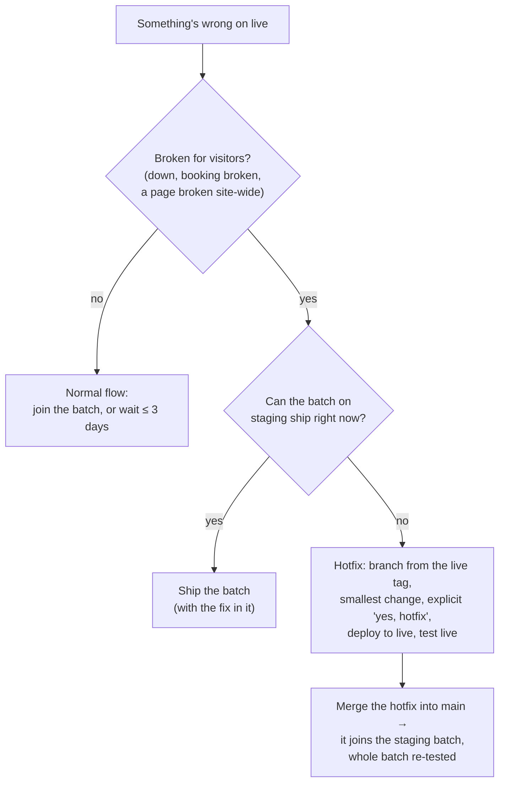

# Two People, One Website -- Batches, Branch Ownership and Staying in Sync
{: .no_toc }

  

    Table of contents
  

  {: .text-delta }
- TOC
{:toc}

Part 5 of the series (start at the [overview](/tech-adventures/wordpress/claude-website-initiative-overview)). Everything so far works beautifully for one person. The harder design problem was two: Qiai and I both change the site, each from our own Mac, each with our own Claude. This post is the set of rules that came out of real questions during the first week, most of them in the order I asked them.

## Question 1: can staging hold more than one change?

The first version of the rules said **one release on staging at a time**. It's the cleanest option for testing: staging = live + exactly one change, so every difference in a test report belongs to that change.

It lasted two days. I had the blog listing on staging, the blog post template finished on Local, and the rule said the second one had to wait until the first was live. My question was: *can't we merge the new one into staging and retest everything?*

Yes, and the rule we landed on is stricter in a different way:

{: .important }
**Staging holds one batch, and the batch ships whole.** More finished changes can join it (each join is a new `uat-*` tag and the full tests run again on everything). Live only ever gets the **newest** tag. Nothing on staging ships on its own: what was tested together is exactly what goes live.

What that cost and how we answered it:

| Concern | Answer |
|---|---|
| One broken part holds up the rest | Accepted. Fix it on a `fix/` branch, or drop it with a `revert/` branch, and the whole batch is re-tested. |
| Test reports get noisier | Each release's expectations file `includes` the earlier ones, so comparisons against live use the whole batch's rules while staging-before-vs-after uses only the new part's. |
| Two people's work ships together | Accepted, explicitly: *anything on staging ships, whoever's work it is.* |
| A batch sits on staging and live moves on underneath it | **A batch goes live within 3 days** of its first tag. The start skill flags a batch that's due. |

The first real batch was three releases: blog listing + blog post template + the daycare post's collapsible sections, all shipped as one on 25 November. That's the [case study](/tech-adventures/wordpress/claude-website-elementor-removal-case-study).

## Question 2: what if something needs fixing *in* the batch?

I'd called it "a step-1-fix branch". The proper version:

- **`fix/<short-name>`** from `main`, commit messages starting `fix:`, released like any change (new `uat-*` tag, whole batch re-tested). Its release note starts with `Fixes uat-…: …`, so the release notes of a batch read as its version history.
- **`revert/<task>`** with `git revert -m 1 <merge commit>`, released the same way, to drop a part entirely.
- **Never** promote an older tag of the batch to get around a broken part.

## Question 3: what about a real emergency?

If the site is down and staging holds a half-tested batch, waiting isn't acceptable. But the hotfix path is deliberately narrow. My framing at the time: *if production is completely down, there's no concern, it can only get better with the deployment.*

The last box matters: after a hotfix, staging must again be *live + the batch*, so the hotfix flows back into the normal path immediately.

## Question 4: what if we both touch the same branch?

Git doesn't lose anything if two people push to one branch: the second push is rejected until it merges the first. But "not losing anything" isn't the same as "safe": you can end up building on someone's half-finished work without knowing it. So:

{: .important }
**A branch belongs to whoever started it.** Only that person's Claude commits to it. The owner is the author of the branch's first commit, compared with the git name on the Mac.

What the skills do about it:

- **`website-start`** lists every open branch (`feature/`, `fix/`, `revert/`, `hotfix/`) with its owner and the files it touches, and flags any overlap with the current request, naming whose it is.
- **`website-change`** checks ownership before resuming a branch. If it's the other person's, it won't commit and offers three ways forward instead: suggest the change to the owner; start your own branch *from* theirs (merged into theirs only with their OK); or wait until theirs is on `main`.

Your own copy of the site is per-Mac, so Local can never collide. Staging is shared, but it only changes through releases, which are already batched.

## Question 5: if my session has been open for 3 days, does it pull before merging?

Yes, through three layers:

1. **`website-start` runs again for every request.** The release skill refuses to continue unless it ran *in the same turn*, so day-3 requests see day-3 state.
2. **`website-change` merges the latest `main`** into the branch before handing over, and the **release gate** requires that, plus a Local check *after* that merge.
3. **GitHub itself** rejects a push to `main` that doesn't contain the other person's commits. Nothing can be overwritten.

{: .note }
Honest gap: the release skill merges about 11 minutes after the "before" tests start, and that step doesn't fetch again. If the other person merges in that window, the push fails safely, but the "before" snapshot of staging would be stale. A fresh fetch right before merging (with a re-run if anything moved) is noted and not yet built. For long gaps, a fresh session is simply cleaner: it also loads any skills the other person changed.

## Question 6: blog posts live in another repo, so where does a blog *feature* go?

Blog post writing runs in my SEO repo, which publishes straight to live through its own checklist (that pipeline is in [Automating YouTube Uploads Into WordPress Blog Posts](/tech-adventures/wordpress/automating-youtube-wordpress-posts)). Then the Elementor removal needed to change *one post's content* to make a new feature work, and the boundary got blurry. The rule we settled on:

| What changes | Where | How it ships |
|---|---|---|
| What a post **says**: wording, headings, links, images, SEO fields, new posts | SEO repo | straight to live with its checklist |
| How posts **look or work**: templates, styling, new kinds of blocks, Elementor removal, and any post-content change that's part of such a feature | `petcoach-website` | Local → staging batch → live, full tests; the content part as a guarded migration |

And the SEO repo got matching rules: check the website repo for a pending migration before editing a post; ask the website repo for anything the template can't do; use the new building blocks (like the collapsible section) freely once they're live; no Elementor in posts.

## Conclusion

Most of these rules came from one question each, asked at the moment it became real, and each one ended up as a numbered rule in the repo and a line or two in a skill. That's the pattern I'd recommend to anyone doing this: don't design the two-person process up front, design the place where its rules live, and add each rule the day you need it. Next, the release that exercised almost all of them: [Case Study: Removing Elementor From the Blog](/tech-adventures/wordpress/claude-website-elementor-removal-case-study).

Until next time, peace and love!
