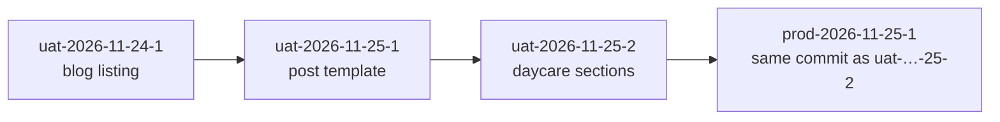

# Case Study -- Removing Elementor From the Blog in One Tested Batch
{: .no_toc }

<details closed markdown="block">
  <summary>
    Table of contents
  </summary>
  {: .text-delta }
- TOC
{:toc}
</details>

Part 6 of the series (start at the [overview](/tech-adventures/wordpress/claude-website-initiative-overview)). The earlier posts describe the flow. This one is the flow under real load: the release that took petcoach.sg's whole blog off Elementor, from "let's stop using Elementor" on 24 November to live on 25 November.

## The goal and the constraints

The decision was simple: **stop using Elementor entirely**, and turn every piece of it into code in the repo. The constraints came from the business side:

- **Keep the look.** Same layout, same fonts (Inter for blog text, Actor where the templates used it). Visitors shouldn't notice.
- **Start small**: the `/blog/` page first, checked on Local by me, then the rest.
- Leftover Elementor-only pages get unpublished later; that's a separate step.

An inventory of what Elementor still did turned up three pieces relevant to the blog:

| Elementor piece | What it rendered |
|---|---|
| Theme Builder **archive** template | `/blog/` and every category/tag/author/date/search listing |
| Theme Builder **single-post** template | All 85 blog posts: title, featured image, post info, table of contents, author box, previous/next |
| Two **saved sections** embedded in one post | Collapsible sections on `/3-best-dog-daycare-singapore/` |

## Step 1: the blog listing (`uat-2026-11-24-1`)

A new mu-plugin, `pc-blog`, takes over the listings with WordPress's `template_include` filter, behind an `ENABLED` switch file (delete it and Elementor's template is back, untouched). The CSS was **measured off live**, not eyeballed: band colour, paddings, the card image's exact transform, the 35-word excerpt rule, the "Load More" behaviour. The local check against the Elementor version came back **0 FAIL**, with pixel differences of 0.2 to 1.7% (card image resampling).

Then I opened it on Local myself and found what the tests can't judge: **the Load More button's text was invisible**, red on red.

{: .note }
Root cause: Elementor's site-wide "kit" stylesheet (`.elementor-kit-6 a { color: … }`) recolours *every* link on the page while Elementor is still active, including ours. The fix was to scope our link colours under `.pc-blog` so they win. Lesson: anything that has to coexist with Elementor during a migration needs its colours scoped, because Elementor's global CSS still loads.

I also asked for one copy fix while we were there: "liked-minded" → "like-minded" in the blog intro. That typo fix is the one that later tripped my own test rule, the story is in [Before and After](/tech-adventures/wordpress/claude-website-release-tests#finding-1-my-own-rule-was-wrong-and-the-test-said-so).

## Step 2: every blog post, built by a parallel agent (`uat-2026-11-25-1`)

While Step 1 was going through staging tests, I asked Claude to spin off a **separate agent** to build Step 2, the post template, on its own branch, working only on Local, with strict instructions: no merging, no tagging, no touching staging or live, and write everything into the plan so another session could pick it up.

It came back with:

- `single.php`, `single.css`, `single.js` in `pc-blog`, behind their own switch file `SINGLE-ENABLED` (so posts can roll back independently of listings).
- Same featured-image crop, title, post info, table of contents (collapsed until opened, same anchor IDs so old saved links still work), content through `the_content()` (so the SEO pipeline's posts keep working untouched), author box, previous/next, reading-progress bar.
- **All 85 posts compared against the Elementor version: 0 FAIL**, pixel differences at most 0.07% on every post but one, head tags (title, canonical, og, Yoast JSON-LD) identical, no sideways scroll at 320px anywhere.

It also brought back three questions, which is exactly what you want from an agent:

1. Elementor's table of contents had been listing the **author's name** as its last entry by accident (it scanned the author box heading). OK to drop it? (Yes. I hadn't even noticed it was gone on Local.)
2. The daycare post embeds two Elementor sections that will break when Elementor is switched off. Rebuild them? (Yes, see Step 3.)
3. Keep the green reading-progress bar? (Yes.)

## Step 3: the daycare post's collapsible sections (`uat-2026-11-25-2`)

The daycare post contained two Essential Addons "Advanced Accordion" widgets, embedded as `[elementor-template id="…"]` shortcodes: a five-part daycare checklist, and a section with our Google reviews and three YouTube videos.


A first draft flattened them into plain headings and paragraphs. My feedback: **keep them collapsible, to save space.** So the rebuild uses the browser's native `<details>`/`<summary>`, which works without any JavaScript, styled to match the old look exactly:

```html
<details class="pc-accordion">
<summary><h3 class="wp-block-heading pc-accordion-title">Handlers Who Understand Dog Body Language</h3></summary>
<div class="pc-accordion-body">
<p>It’s crucial that staff are well-versed in <a href="…/dog-body-language/">canine body language</a>. …</p>
</div>
</details>
```

The heading stays an `<h3>` inside `<summary>`, so the post's table of contents still lists all nine sections with the same anchors.


### A live bug fixed for free

While rebuilding, the agent noticed that the three videos inside the old accordions showed **YouTube "Error 153"** on the live site: the Elementor widget's iframes lacked `referrerpolicy="strict-origin-when-cross-origin"`, the exact problem I wrote about in [Fixing YouTube Embed Error 153 in Elementor](/tech-adventures/wordpress/fixing-youtube-embed-error-153-elementor). The rebuilt sections carry the attribute, so they play again.

### Content changes as a guarded migration

This was the first time a *feature* needed a blog post's content to change, and post content normally belongs to my SEO repo. The rule we settled on (see [Two People, One Website](/tech-adventures/wordpress/claude-website-two-people-one-site#question-6-blog-posts-live-in-another-repo-so-where-does-a-blog-feature-go)): a content change that's part of a feature ships from the website repo as a **migration**. Migration `0001-daycare-post-accordions` holds:

- `before.prod.html`, the post's content read from live,
- `after.html`, built from it by a small script,
- `apply.mjs --site local|uat|prod [--dry-run]`, which **refuses to write** unless the post still matches "before", backs up the full post record, writes "after", reads it back to confirm, and logs the run.

The dry runs before release, real output:

```
local: already applied, nothing to do.
uat:   post 9211 "3 Best Doggy Daycares in Singapore" … dry run, content matches "before"; would write after.html (15695 chars).
prod:  post 9211 "3 Best Doggy Daycares in Singapore" … dry run, content matches "before"; would write after.html (15599 chars).
```

(The two sizes differ only because each site's copy has its own domain in absolute links.)

### The local check caught a real difference

The one local check before staging found two things. One was a measuring quirk (text inside closed `<details>` is now measurable, where Elementor's hidden accordion content wasn't). The other was real: **section text was 15px on mobile instead of 16px**, because the sections inherited the post's mobile font size while the old widget had its own. One CSS line fixed it, and the re-check came back 0 FAIL, 0 WARN.


## Shipping the batch

All three steps sat on staging as one batch and went live together:



| Run | Result |
|---|---|
| Staging after vs staging before (the newest part) | 0 FAIL, 10 WARN, 242 OK |
| Staging after vs live (the whole batch's rules) | 0 FAIL, 18 WARN, 234 OK, **1,409 differences all accounted for** |
| Live after vs live before | 0 FAIL, 18 WARN, 234 OK |
| Live after vs staging after | 0 FAIL, 6 WARN, 246 OK |

The WARNs were the expected card-image pixel differences, the footer's logo carousel caught mid-scroll, and third-party noise (YouTube's `establish_zw` request being cancelled, a browser `compute-pressure` permissions message).

One honest moment during the live deploy: the old upload tool reported nothing for one file, and the file wasn't there. A re-check of every file before flipping the switches caught it. That's why deploys now verify themselves, see [Making the Repo Standalone](/tech-adventures/wordpress/claude-website-standalone-repo).

## Conclusion

Three changes, one built by a parallel agent, one that needed a content migration across a repo boundary, all tested together and shipped as one, with a live bug fixed on the way and a rollback that's still just "delete a file". If I had to name the single thing that made this calm rather than risky, it's the expectations file: by the time I said "push to production", every one of 1,409 differences had a written reason.

That's a wrap! Peace and love, Shafik.
