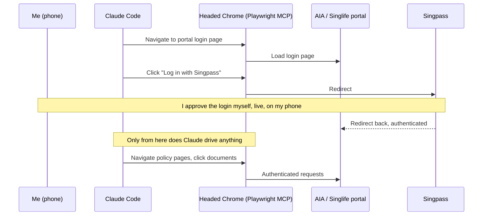

# Can an AI Agent Touch Singpass? What's Actually Safe to Automate
{: .no_toc }

<details closed markdown="block">
  <summary>
    Table of contents
  </summary>
  {: .text-delta }
- TOC
{:toc}
</details>

I have six insurance policies spread across two insurers -- AIA and Singlife -- and until recently I had no real record of what any of them actually covered. Premiums, coverage limits, claim history: all of it lived inside two separate web portals, both gated behind Singpass, Singapore's national digital identity login. Getting a proper written record meant logging into each portal and manually working through years of documents.

The obvious move was to get Claude Code to do it. The obvious objection was just as immediate: Singpass is how I prove who I am to the Singapore government and, by extension, to any service that relies on it. Handing that to an AI agent sounds like exactly the kind of thing you shouldn't automate.

It turns out the honest answer isn't "I made sure to be careful with the login" -- it's that **Singpass itself won't let a script log in, full stop**. The safety here isn't a design choice I get credit for. It's a structural fact about how Singpass works, and everything about how this was set up follows from that fact.

## What Singpass actually is

Singpass login isn't a username and a password sitting in a database somewhere. Logging in means one of:

- Entering your NRIC or mobile number, then approving a push notification inside the Singpass app on your own phone, or
- A password plus a one-time code, as a fallback.

Either way, there is no static secret -- no string of characters -- that represents "being logged in as me." The approval step happens on a device I physically hold, at the moment I choose to approve it. There is nothing to steal, store, or replay, because there's nothing there in the first place.

{: .important }
This means "store Singpass credentials so the agent can log in on its own" was never actually an option on the table -- not because I decided against it, but because there's no credential-shaped thing to store. Every plan for this project had to start from that fact, not work around it.

## So what does the automation actually do?

Given that, the design question becomes much narrower: what's left to automate *once a human has already logged in*? The answer is everything downstream of the login -- clicking through a portal's menus, opening documents, reading structured data off a page -- none of which touches identity verification at all.



The tool for the "browser" part is [Playwright MCP](https://github.com/microsoft/playwright-mcp) -- an MCP server that gives Claude Code the ability to open a real Chrome window and drive it (navigate, click, read the page). If you haven't run into MCP servers before, [this series' earlier post on what an MCP server actually is](/tech-adventures/general-tech/mcp-server-mental-model) is a good primer -- the short version is that it's a small local process exposing a fixed set of tools (`browser_navigate`, `browser_click`, and so on) that Claude Code calls the same way it calls any other tool.

It's registered like this:

```bash
claude mcp add insurance-browser --scope local -- npx -y @playwright/mcp@latest \
  --user-data-dir ".../insurance-policies/.browser-profile" \
  --output-dir ".../insurance-policies/.downloads-staging"
```

Two things about that command matter more than they look like they should:

**No `--headless` flag.** The browser opens as a real, visible window, because Singpass approval genuinely requires a human to see and interact with the login page. A headless (invisible) browser would make the human-in-the-loop step impossible, not just harder -- so headed-by-default isn't a debugging convenience here, it's load-bearing.

**A persistent `--user-data-dir`.** This is the one place worth being precise about, because "the browser remembers you" sounds uncomfortably close to "the login is automated" if you don't look closely. It isn't. This directory stores the *portal's own* session cookies -- AIA's and Singlife's, not Singpass's -- so a follow-up visit might skip a fresh Singpass approval if the portal itself still trusts the browser (much like staying logged into a website on your own laptop). Singpass's own login step happens fresh, live, on my phone, every single time it's actually required. Nothing about Singpass is cached, because -- as covered above -- there's nothing Singpass-shaped to cache.

## The part that keeps this honest, even when it's inconvenient

Both portals' sessions expire roughly hourly (visible in the JWT tokens issued after login), and can drop unpredictably mid-task -- an API call suddenly returns `401 Unauthorized`, or the page silently bounces back to the homepage. When that happens, the only correct move is to stop and ask me to log in again.

{: .warning }
It would have been technically possible to build something that tries to route around a dropped session -- retry logic, alternate navigation paths, anything to avoid interrupting the work. None of that was built, on purpose. A dropped session is Singpass (indirectly) enforcing that a human is still present and willing to re-verify. Working around that defeats the entire point of the design.

That friction -- an hourly wall you can't script past -- is, in a real sense, the thing that makes the rest of this safe to have built at all. [Part 2 of this series](/tech-adventures/general-tech/ai-insurance-bulk-document-download) covers what actually happened once a session was live: finding six years of documents across two insurers, a genuinely funny fight with a popup blocker, and how much time this actually saved once it worked.

Until next time, peace and love!
