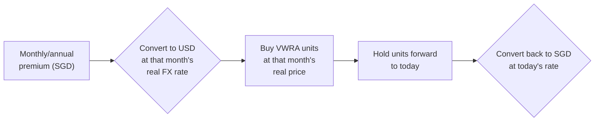

# Checking Whether an Insurance "Investment" Ever Beats the Market — With Real Historical Prices
{: .no_toc }

<details closed markdown="block">
  <summary>
    Table of contents
  </summary>
  {: .text-delta }
- TOC
{:toc}
</details>

A family member of mine has held a handful of older insurance-linked plans (ILPs) and a traditional whole life policy for years — the kind that bundle life/critical-illness protection together with an "investment" component that's supposed to grow alongside it. The pitch, back when these were sold, was always some version of "you get protected *and* your money grows." Nobody had ever actually gone back and checked whether the growing part was true.

So I did. Not with a rough guess or an insurer's own illustration — with the actual real historical prices of the actual underlying funds, checked against what a plain world-index fund would have done with the exact same money, on the exact same dates.

{: .warning }
Genericised throughout. The person involved isn't named, and the dollar figures shown are representative, not the real numbers — swapped out to keep their finances private. The product names (they're real, publicly named insurance products) and the methodology are exactly as they happened.

## The setup: three policies, one real question

Three policies, two different mechanisms:

- Two **Investment-Linked Policies (ILPs)** from the same insurer — each one buys units in a handful of named sub-funds, and the death/disability/critical-illness protection is paid for by deducting monthly charges *from those same units*.
- One **traditional participating whole life** policy from a different insurer — premiums go into a pooled fund, and the insurer declares an annual "bonus" at its own discretion, rather than pricing individual units.

The question was simple to ask and, it turns out, genuinely hard to answer properly: **for the money that went into the "investment" side of these three policies, would a plain, boring world-index ETF have done better?**

{: .highlight }
Spoiler: yes, by a wide margin, on all three — and the *reason* was different for each policy, which is the more useful finding.

## Why this is normally hard to check

An insurance account value isn't quoted anywhere public. You get whatever number the insurer's portal shows you today, and that's it — no historical chart, no way to verify it independently.

The first real surprise: **the underlying sub-funds inside the two ILPs are actually on Yahoo Finance.** They're fed through the same Morningstar data pipe as any other mutual fund, under slightly obscure tickers (`0P00008T6M.SI`-style identifiers) that don't show up if you just search the fund's plain-English name — you have to already suspect they exist. Once found, real historical monthly prices were sitting there, going back to late 2017, for free.

```bash
curl -s -A "Mozilla/5.0" \
  "https://query1.finance.yahoo.com/v8/finance/chart/0P00008T6M.SI?range=max&interval=1mo" \
  -o aia_regional.json
```

{: .note }
No API key, no auth — Yahoo's chart endpoint is just a plain JSON GET. The hard part isn't the fetch, it's knowing the ticker exists at all.

The traditional whole life policy has no equivalent. It's genuinely not unit-priced — more on that further down, because *why* it isn't is more interesting than "the data wasn't available."

## Building the actual model

The model had to respect how the money actually moved, not a simplified annual approximation:

- One policy pays **monthly** — modeled as 105 separate monthly unit purchases, each at that specific month's real fund price, not a yearly lump sum.
- The other two pay **annually**, on their real anniversary dates — modeled exactly that way.
- Each contribution was split across the policy's actual disclosed fund allocation (e.g. 40% into one regional-equity fund, 30% into another, 30% into a third), buying real units at the real price on that date, tracked forward to today.

The comparison side used **VWRA** (a globally diversified world-index ETF), not the S&P 500 — the S&P 500 is US-only and has had an unusually strong run this decade, which would make the comparison less honest. VWRA's real price history only starts mid-2019, so for the stretch before that, a real global-market index return was used as a bridge, clearly logged as such rather than silently blended in. Every SGD contribution was converted to USD at that month's *real* exchange rate before "buying" VWRA units, and converted back at today's rate for the final number — currency risk isn't a rounding error over a decade, so it got modeled properly instead of ignored.



### Two real data problems, and how each was handled

{: .warning }
A supposedly reliable public data feed had a silent 3-year gap. Finding this mattered more to the result than any of the modeling choices.

The first fund's price history had a run of `0` values for two consecutive months — obviously a feed glitch, not a real 90%+ crash. That one was easy: skip zeros, fall back to the nearest real price.

The second problem was bigger: **all five of the insurer's fund tickers went completely silent for the same ~3-year stretch**, both in monthly and daily granularity. Not a couple of missing points — a clean, identical gap across five otherwise-unrelated fund tickers. That pattern rules out coincidence; it's a feed/vendor issue on the data provider's side, not noise in any individual fund.

{: .important }
The fix: bridge the gap using the real global-index return as a proxy for those specific months, then reconnect to the real fund price the moment the feed resumes — and disclose which direction the bridge probably biases the result (in this case, generously *toward* the insurance product, since the region-specific funds being bridged actually underperformed global markets during exactly that stretch in reality). A model that hides its own data gaps is worse than one that shows its seams.

## The finding: none of the three beat the market


Rounded, real, historical numbers — each policy compared over its own actual lifespan (roughly 9, 4, and 15 years respectively, since that's how long each has actually existed):

| Policy | Premiums paid in | Actual value today | Same money, in VWRA instead |
|---|---:|---:|---:|
| ILP #1 (~9 years) | ~SGD 37,000 | ~SGD 34,000 | ~SGD 67,000 |
| ILP #2 (~4 years) | ~SGD 19,000 | ~SGD 11,500 | ~SGD 28,000 |
| Whole life (~15 years) | ~SGD 25,500 | ~SGD 18,000 | ~SGD 53,000 |

Two of the three are worth sitting with for a second: **the actual account value today is *below* total premiums paid in** — after 9 years and after 4 years respectively. Not "grew slower than the market" — actually underwater, in absolute terms, despite nearly a decade of real market growth happening around it.

## Decomposing *why* — two different failure modes, not one

Because the two ILPs' real underlying fund prices were fetchable, the gap could be split into two genuinely separate causes rather than one vague "insurance is bad" conclusion:

1. **Fee/charge drag** — the actual account value vs. what the real underlying funds did, before any charges.
2. **Fund-selection drag** — what the real underlying funds did vs. what a global index did over the same stretch.

| | ILP #1 | ILP #2 |
|---|---:|---:|
| Fee/charge drag | ~26% of real gross growth | **~57% of real gross growth** |
| Fund-selection drag | the larger of the two factors here | a small factor here |

{: .important }
These are two different products failing for two different reasons. ILP #1's bigger problem was **fund selection** — a heavily region-concentrated fund mix that genuinely lagged a global index over this exact stretch, independent of what the insurer charged. ILP #2's bigger problem was **fees**, overwhelmingly — its own underlying funds actually performed reasonably well, but more than half of that real growth never reached the policyholder. Same insurer, same broad product category, opposite root cause.

## The whole life policy's opacity is a feature, not a bug

The traditional whole life policy couldn't get the same fund-price treatment, and the reason is worth spelling out rather than treating as a data-availability shrug:

| | ILP (unit-linked) | Traditional whole life (participating) |
|---|---|---|
| Where premiums go | Named, individually-priced sub-funds | One pooled fund, mixed across every policyholder |
| What generates growth | The real market price of the chosen fund | Investment surplus, allocated at the insurer's discretion as an annual "bonus" |
| Verifiable day to day? | Yes — same as checking any stock/fund price | No — an annual bonus rate, nothing traceable further |
| Smoothing | None — real-time market exposure | Deliberate — the insurer holds bonus rates steady across good and bad years on purpose |

{: .note-title }
> Confirmed directly, not assumed
>
> The whole life policy's own bonus statements show its declared rate held perfectly flat through a year the underlying participating fund *actually returned −7.6%*. That's not an oversight — smoothing bad years is the literal product design, meant to protect policyholders from short-term volatility. It just also means "transparent, independently-verifiable pricing" and "this product category" are close to mutually exclusive, by design, everywhere this product type is sold — not a flaw specific to this one insurer.

## What this took, and what happens next

Building this — fetching five obscure fund tickers, discovering and bridging a real 3-year data gap, simulating monthly and annual unit purchases with proper FX handling, and decomposing the result into fees vs. fund selection — took an AI agent **about an hour**, once the approach was worked out. A financial analyst doing the equivalent by hand — assuming they even knew to check whether these fund prices were public at all — would realistically be looking at a full day's work or more, and that's before writing it up.

That's the subject of [the next post](/tech-adventures/general-tech/insurance-sunk-cost-forward-projection) — including the harder question this one doesn't answer on its own: given the "loss" already sitting there today, does it actually make sense to lock it in, or was a recovery about to happen anyway? That needs a forward-looking projection, not just a historical one, and it produced one result that genuinely wasn't a landslide either way — which turned out to be the most interesting part of the whole exercise.

## Images Required

None — both charts in this post are generated directly from the real analysis, not placeholders.

Until next time, peace and love!
